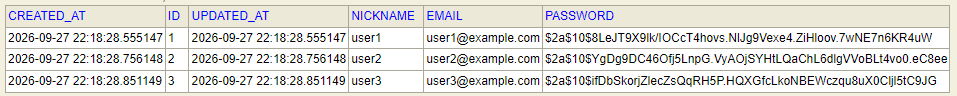

# Board REST API

Spring Boot 3.5, Spring Data JPA, Spring Security를 사용한 게시판 REST API입니다.

## 실행 방법

### 요구 사항

- JDK 17 이상
- 별도 DB 설치 불필요
- 기본 DB는 H2 인메모리 데이터베이스

### 실행

Windows:

```bash
gradlew.bat bootRun
```

macOS/Linux:

```bash
./gradlew bootRun
```

서버는 기본적으로 `http://localhost:8080`에서 실행됩니다. H2 콘솔은 `http://localhost:8080/h2-console`이며, JDBC URL은 다음과 같습니다.

```text
jdbc:h2:mem:board
```

애플리케이션 실행 시 테스트용 사용자와 게시글·댓글 데이터가 자동으로 생성됩니다.

| 이메일 | 비밀번호 | 닉네임 |
| --- | --- | --- |
| `user1@example.com` | `password123` | `user1` |
| `user2@example.com` | `password123` | `user2` |
| `user3@example.com` | `password123` | `user3` |

## 인증 방식

세션 기반 인증을 사용합니다. 로그인 성공 시 서버가 `JSESSIONID` 쿠키를 발급하며, 이후 인증이 필요한 요청은 해당 쿠키를 함께 보내야 합니다.

세션 방식은 브라우저 기반 게시판에서 사용하기 쉽고, 서버에서 세션 만료·로그아웃·인증 상태를 관리할 수 있어 이 프로젝트에 적합하다고 판단했습니다. REST 클라이언트에서는 로그인 응답의 쿠키를 저장한 뒤 요청마다 사용합니다.

현재 CSRF는 REST API 호출 편의를 위해 비활성화되어 있습니다. 실제 브라우저 서비스로 운영할 때는 CSRF 토큰 적용을 권장합니다.

## API 명세

### 공통 사항

- 기본 주소: `http://localhost:8080`
- JSON 요청/응답 사용
- 날짜 형식: ISO-8601 LocalDateTime
- `GET /api/posts/**`는 비로그인 접근 가능
- 작성·수정·삭제 API는 로그인 필요
- 작성자 ID는 요청 본문으로 받지 않고 세션의 로그인 사용자로 결정

### 회원가입

#### `POST /api/auth/signup`

인증 불필요

요청:

```json
{
  "email": "new-user@example.com",
  "password": "password123",
  "nickname": "새 사용자"
}
```

성공 `201 Created`:

```json
{
  "id": 4,
  "email": "new-user@example.com",
  "nickname": "새 사용자",
  "createdAt": "2026-09-27T20:00:00"
}
```

비밀번호는 응답에 포함되지 않으며 BCrypt로 해시되어 저장됩니다.


### 로그인

#### `POST /api/auth/login`

인증 불필요. 성공 시 `JSESSIONID` 쿠키가 발급됩니다.

요청:

```json
{
  "email": "new-user@example.com",
  "password": "password123"
}
```

성공 `200 OK`:

```json
{
  "id": 4,
  "email": "new-user@example.com",
  "nickname": "새 사용자",
  "createdAt": "2026-09-27T20:00:00"
}
```

### 로그아웃

#### `POST /api/auth/logout`

인증 불필요

성공 `204 No Content`

### 게시글 작성

#### `POST /api/posts`

인증 필요

요청:

```json
{
  "title": "새 게시글",
  "content": "게시글 본문입니다."
}
```

성공 `201 Created`:

```json
{
  "id": 31,
  "title": "새 게시글",
  "content": "게시글 본문입니다.",
  "authorId": 4,
  "authorNickname": "새 사용자",
  "commentCount": 0,
  "createdAt": "2026-09-27T20:01:00",
  "updatedAt": "2026-09-27T20:01:00"
}
```

### 게시글 목록

#### `GET /api/posts?page=0&size=20`

인증 불필요. 최신순 페이징입니다.

성공 `200 OK`:

```json
{
  "content": [
    {
      "id": 31,
      "title": "새 게시글",
      "content": "게시글 본문입니다.",
      "authorId": 4,
      "authorNickname": "새 사용자",
      "commentCount": 0,
      "createdAt": "2026-09-27T20:01:00",
      "updatedAt": "2026-09-27T20:01:00"
    }
  ],
  "pageable": { "pageNumber": 0, "pageSize": 20 },
  "totalElements": 31,
  "totalPages": 2,
  "last": false
}
```

### 게시글 상세

#### `GET /api/posts/{postId}`

인증 불필요. 성공 `200 OK`이며 게시글 응답 형식은 게시글 작성 응답과 같습니다. 존재하지 않는 게시글은 `404 Not Found`입니다.

### 게시글 수정

#### `PUT /api/posts/{postId}`

인증 필요. 로그인한 사용자가 작성한 게시글만 수정할 수 있습니다.

요청:

```json
{
  "title": "수정된 제목",
  "content": "수정된 본문"
}
```

성공 `200 OK`. 타인의 게시글이면 `403 Forbidden`입니다.

### 게시글 삭제

#### `DELETE /api/posts/{postId}`

인증 필요. 성공 `204 No Content`. 타인의 게시글이면 `403 Forbidden`입니다.

게시글 삭제 시 JPA의 `cascade = CascadeType.ALL`, `orphanRemoval = true` 설정으로 해당 게시글의 댓글도 함께 삭제됩니다.

### 댓글 작성

#### `POST /api/posts/{postId}/comments`

인증 필요

요청:

```json
{
  "content": "댓글입니다."
}
```

성공 `201 Created`:

```json
{
  "id": 1,
  "content": "댓글입니다.",
  "authorId": 4,
  "authorNickname": "새 사용자",
  "postId": 31,
  "createdAt": "2026-09-27T20:02:00",
  "updatedAt": "2026-09-27T20:02:00"
}
```

### 댓글 목록

#### `GET /api/posts/{postId}/comments`

인증 불필요. 성공 `200 OK`이며 댓글 배열을 반환합니다. 대댓글은 `parentComment` 관계로 저장됩니다.

### 댓글 수정

#### `PUT /api/comments/{commentId}`

인증 필요

요청:

```json
{
  "content": "수정된 댓글입니다."
}
```

성공 `200 OK`. 타인의 댓글이면 `403 Forbidden`입니다.

### 댓글 삭제

#### `DELETE /api/comments/{commentId}`

인증 필요. 성공 `204 No Content`. 타인의 댓글이면 `403 Forbidden`입니다.

## 오류 응답

모든 애플리케이션 오류는 다음 형식을 사용합니다.

```json
{
  "status": 404,
  "message": "게시글을 찾을 수 없습니다.",
  "timestamp": "2026-09-27T20:03:00"
}
```

| 상태 코드 | 의미 |
| --- | --- |
| `400` | 잘못된 입력값 |
| `401` | 로그인하지 않은 상태에서 인증 필요 API 호출 또는 로그인 실패 |
| `403` | 다른 사용자의 게시글·댓글 수정/삭제 시도 |
| `404` | 회원·게시글·댓글을 찾을 수 없음 |
| `409` | 이미 가입된 이메일 |

## 설계 설명

### 엔티티 관계

- `Member 1:N Post`: 회원은 여러 게시글을 작성합니다.
- `Member 1:N Comment`: 회원은 여러 댓글을 작성합니다.
- `Post 1:N Comment`: 게시글은 여러 댓글을 가집니다.
- `Comment 1:N Comment`: 댓글은 `parent_comment_id`로 한 단계 대댓글을 가질 수 있습니다.
- 게시글 삭제 시 댓글은 cascade와 orphan removal로 함께 삭제됩니다.

### N+1 방지

To-One 관계는 ```@EntityGraph```를 통해 페치조인 하도록 하였습니다. 
To_Many 관계는 ```default_batch_fetch_size=500``` 을 통해 N+1 문제를 방지하도록 했습니다.

### DTO 사용

컨트롤러 요청/응답에는 `MemberDto`, `PostDto`, `CommentDto`를 사용하며 JPA 엔티티를 직접 노출하지 않습니다. 비밀번호는 어떠한 응답 DTO에도 포함되지 않습니다.

## 실행 결과

아래 예시는 Windows `curl.exe` 기준입니다. 로그인 때 `-c cookie.txt`로 세션 쿠키를 저장하고, 이후 `-b cookie.txt`로 전송합니다.

### 1. 회원가입

```bash
curl.exe -i -X POST http://localhost:8080/api/auth/signup ^
  -H "Content-Type: application/json" ^
  -d "{\"email\":\"demo@example.com\",\"password\":\"password123\",\"nickname\":\"demo\"}"
```

```text
HTTP/1.1 201 Created
```

```json
{
  "id": 4,
  "email": "demo@example.com",
  "nickname": "demo",
  "createdAt": "2026-09-27T20:00:00"
}
```

### 2. 로그인

```bash
curl.exe -i -c cookie.txt -X POST http://localhost:8080/api/auth/login ^
  -H "Content-Type: application/json" ^
  -d "{\"email\":\"demo@example.com\",\"password\":\"password123\"}"
```

```text
HTTP/1.1 200 OK
Set-Cookie: JSESSIONID=...; Path=/; HttpOnly
```

### 3. 글 쓰기

```bash
curl.exe -i -b cookie.txt -X POST http://localhost:8080/api/posts ^
  -H "Content-Type: application/json" ^
  -d "{\"title\":\"curl 게시글\",\"content\":\"본문입니다.\"}"
```

```text
HTTP/1.1 201 Created
```

### 4. 댓글 쓰기

여기서 `31`은 위에서 생성된 게시글 ID라고 가정합니다.

```bash
curl.exe -i -b cookie.txt -X POST http://localhost:8080/api/posts/31/comments ^
  -H "Content-Type: application/json" ^
  -d "{\"content\":\"첫 댓글입니다.\"}"
```

```text
HTTP/1.1 201 Created
```

### 5. 목록 조회

```bash
curl.exe -i http://localhost:8080/api/posts?page=0^&size=20
```

```text
HTTP/1.1 200 OK
```

응답 본문은 `content`, `totalElements`, `totalPages`를 포함하는 Spring Data 페이지 형식입니다.

### 6. 401 예시

로그인하지 않은 상태에서 글 쓰기를 요청합니다.

```bash
curl.exe -i -X POST http://localhost:8080/api/posts ^
  -H "Content-Type: application/json" ^
  -d "{\"title\":\"실패\",\"content\":\"로그인 필요\"}"
```

```text
HTTP/1.1 401 Unauthorized
```

### 7. 403 예시

user1로 게시글을 작성한 뒤 user2 세션으로 해당 게시글을 수정하면 `403 Forbidden`이 반환됩니다.

```bash
curl.exe -i -b user2-cookie.txt -X PUT http://localhost:8080/api/posts/31 ^
  -H "Content-Type: application/json" ^
  -d "{\"title\":\"타인 글 수정\",\"content\":\"수정 불가\"}"
```

```text
HTTP/1.1 403 Forbidden
```

## 테스트

```bash
gradlew.bat test
```
